<!-- HEADER — switches automatically with the viewer's GitHub theme -->
<picture>
  <source media="(prefers-color-scheme: dark)"  srcset="./assets/header-dark.svg">
  <source media="(prefers-color-scheme: light)" srcset="./assets/header-light.svg">
  
</picture>

  
  
  
  

 

### About

I'm a backend engineer who builds **reliable, event-driven systems with Java and Spring Boot** — and increasingly, the **AI layer on top of them**.
I've shipped microservices for fleet management, document AI (OCR) and RFID asset tracking, and I care about clean APIs, observability and systems that are boring to operate.

<table>
<tr>
<td width="25%" valign="top">

🔵 **Backends** 
Spring Boot microservices, REST, clean domain design

</td>
<td width="25%" valign="top">

🟣 **AI systems** 
LLM integration, RAG, tool-calling agents with Spring AI

</td>
<td width="25%" valign="top">

🟢 **Data pipelines** 
Kafka event streams, PostgreSQL, Redis, MongoDB

</td>
<td width="25%" valign="top">

🟠 **Cloud infra** 
Docker, Kubernetes, AWS, CI/CD with GitHub Actions

</td>
</tr>
</table>

 

### Stack

  <picture>
    <source media="(prefers-color-scheme: dark)" srcset="https://skillicons.dev/icons?i=java%2Cspring%2Ckafka%2Cnodejs%2Cpython%2Cpostgres%2Cmysql%2Cmongodb%2Credis%2Cdocker%2Ckubernetes%2Caws%2Cgithubactions%2Cnginx%2Clinux%2Cgit&theme=dark&perline=8">
    
  </picture>

 

### Selected work

<table>
<tr>
<td width="50%" valign="top">

🔵 **[fintech-oauth2-oidc-microservices](https://github.com/Jyotipr45/fintech-oauth2-oidc-microservices)** 
Banking microservices secured with OAuth 2.0, OpenID Connect and RS256 JWT — Keycloak, Spring Security 6 and Spring Cloud Gateway.  
`Java 17` `Spring Boot 3` `Keycloak`

</td>
<td width="50%" valign="top">

🟣 **[stream-lab](https://github.com/Jyotipr45/stream-lab)** 
Hands-on Apache Kafka and Kafka Streams experiments running on KRaft.  
`Kafka` `Kafka Streams` `Spring Boot 3`

</td>
</tr>
<tr>
<td width="50%" valign="top">

🟢 **[distributed-coupon-system](https://github.com/Jyotipr45/distributed-coupon-system)** 
Distributed coupon service built in Java.  
`Java` `Distributed systems`

</td>
<td width="50%" valign="top">

🟠 **[car-rental-system-lld](https://github.com/Jyotipr45/car-rental-system-lld)** 
Low-level design with SOLID and classic patterns, plus double-booking prevention under concurrency.  
`Java 17` `LLD` `Design patterns`

</td>
</tr>
</table>

 

### Activity

  <picture>
    <source media="(prefers-color-scheme: dark)" srcset="https://streak-stats.demolab.com?user=Jyotipr45&hide_border=true&background=0b0d14&ring=7c3aed&fire=ec4899&currStreakNum=f8fafc&sideNums=f8fafc&currStreakLabel=a78bfa&sideLabels=94a3b8&dates=64748b&stroke=1e2433">
    
  </picture>

  <picture>
    <source media="(prefers-color-scheme: dark)" srcset="https://github-readme-activity-graph.vercel.app/graph?username=Jyotipr45&bg_color=0b0d14&color=94a3b8&line=7c3aed&point=ec4899&area=true&area_color=7c3aed&hide_border=true&title_color=f8fafc">
    
  </picture>

  <picture>
    <source media="(prefers-color-scheme: dark)" srcset="https://raw.githubusercontent.com/Jyotipr45/Jyotipr45/output/github-snake-dark.svg">
    
  </picture>

 

  Currently building AI features on Spring Boot · learning Kubernetes and Terraform · open to backend and AI engineering roles

